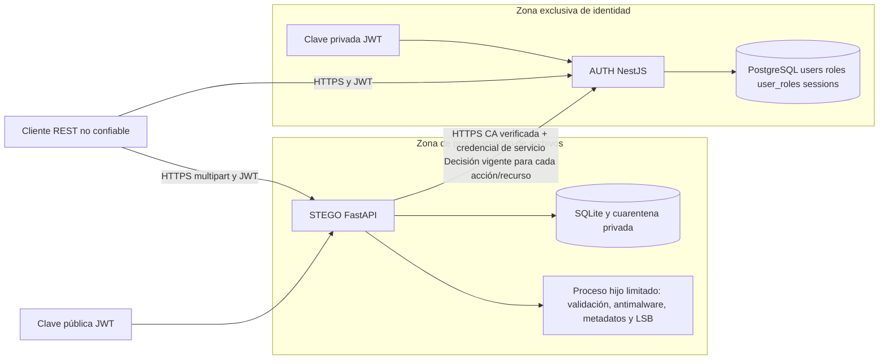
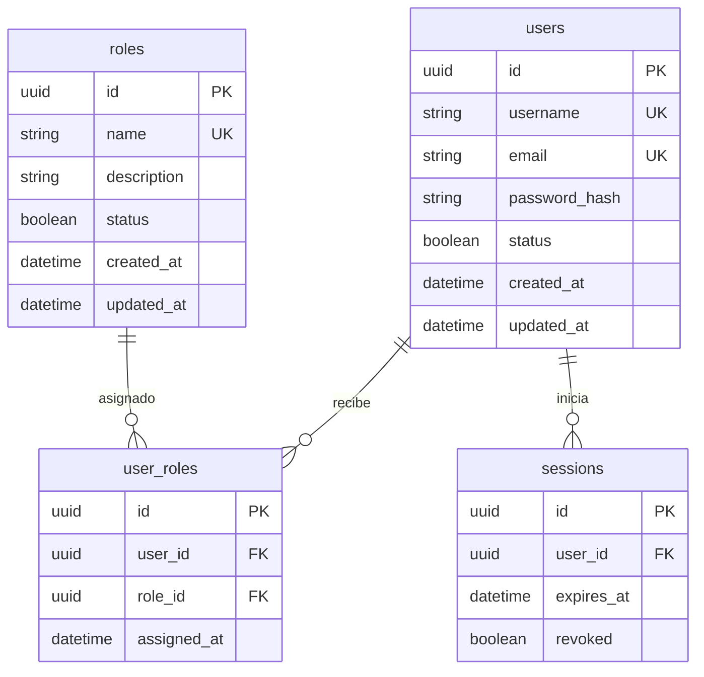

# Arquitectura y modelo de identidad

**Estado actual:** RBAC y la autorización vigente permanecen activos. El detector
de Diana ya se integra en STEGO: validación, ClamAV/YARA, ExifTool y análisis LSB
PNG. Ver [evidencia y límites](../services/stego/VALIDACION_DIANA.md); la ejecución
de toda la pila AUTH/PostgreSQL con este detector aún requiere sustentación.

## Límites de confianza

Dos aplicaciones con Dockerfiles, configuración, APIs, documentación y ciclos de vida separados. STEGO puede iniciarse sin AUTH, pero las operaciones protegidas fallan de forma segura si AUTH no proporciona una decisión verificable. PostgreSQL está únicamente en la red `identity`; STEGO no tiene sus credenciales. Las llamadas internas usan HTTPS con CA y verificación de hostname; la identidad STEGO se acredita con secreto aleatorio distinto de las claves JWT.

AUTH organiza sus dominios en módulos `users`, `roles`, `user-roles`, `auth` y `authorization`. Usuarios/roles/asignaciones separan controller, service, DTO y entities conforme a las referencias locales; el modelo persistido del PDF continúa en Prisma. DatabaseModule comparte una única conexión de Prisma y AuthModule exporta la validación a autorización. Los guards globales aplican límite de intentos, JWT/sesión y roles vigentes, en ese orden.

## Entidad–relación

`UNIQUE(user_id, role_id)` impide duplicados. Se pueden asignar varios roles a un usuario y el mismo rol a varios usuarios. Las FK evitan referencias inexistentes. No se replican estas tablas en STEGO.

## Matriz de permisos

| Acción | Sin autenticación | USER | ANALYST | ADMIN |
|---|---|---|---|---|
| Registro/login | Sí, con límites | Sí | Sí | Sí |
| Perfil propio/logout | No | Sí | Sí | Sí |
| Administrar usuarios, roles y asignaciones | No | No | No | Sí |
| Analizar imagen | No | No | Sí | Sí |
| Consultar resultado propio | No | No | Sí | Sí |
| Consultar resultado ajeno | No | No | No | Sí |
| Decisión interna AUTH | Solo identidad STEGO; un JWT ADMIN no sustituye esa credencial ||||

Un usuario sin roles puede consultar perfil y cerrar sesión. Los permisos se acumulan por unión de roles activos. Una cuenta inactiva o sesión revocada se rechaza antes de evaluar roles. No se confía en roles de JWT ni en cabeceras del cliente.

## Claves y vigencia

JWT RS256 con RSA 3072 generada localmente, privada solo en AUTH; STEGO recibe únicamente clave pública. JWT incluye `sub`, `jti`, `email`, `iss`, `aud`, `iat`, `exp`; no contiene contraseña ni roles. AUTH vuelve a validar sesión y estado con PostgreSQL. Retirar asignación afecta a la próxima decisión; logout revoca `jti`; desactivar cuenta revoca sesiones. Cada solicitud autorizada constituye una decisión puntual, sin cache; una operación ya autorizada no se cancela retroactivamente.

TLS usa un par diferente del par JWT. La CA local y hostname se verifican, sin `verify=False`. Certificados de desarrollo de 90 días; despliegue público requiere gestión de certificados y secretos operativa. El diseño toma referencias de ISO/IEC 27001 y 27034 sin afirmar certificación.
